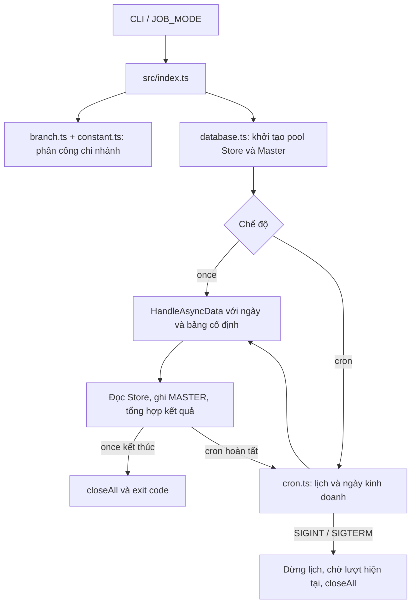

# Manual Async Job

Worker Node.js/TypeScript đồng bộ dữ liệu giữa các SQL Server. Dự án có **hai chế độ chính**: chạy một lần (`once`) và chạy định kỳ (`cron`), cùng ba script thủ công cho các tác vụ riêng.

Tài liệu mô tả **hành vi đang có trong source**, gồm cả những phần chưa bật. Ứng dụng không có HTTP server, REST API hay giao diện cấu hình.

## Mục lục

- [1. Chọn cách chạy và hiểu phạm vi](#1-chọn-cách-chạy-và-hiểu-phạm-vi)
- [2. Cài đặt và cấu hình kết nối](#2-cài-đặt-và-cấu-hình-kết-nối)
- [3. Chạy bằng Node.js](#3-chạy-bằng-nodejs)
- [4. Chạy bằng Docker Compose](#4-chạy-bằng-docker-compose)
- [5. Chạy định kỳ bằng PM2](#5-chạy-định-kỳ-bằng-pm2)
- [6. Chỉnh ngày, bảng, lịch và chi nhánh](#6-chỉnh-ngày-bảng-lịch-và-chi-nhánh)
- [7. Các script thủ công](#7-các-script-thủ-công)
- [8. Đọc kết quả, log và xử lý lỗi](#8-đọc-kết-quả-log-và-xử-lý-lỗi)
- [9. Kiến trúc và luồng dữ liệu](#9-kiến-trúc-và-luồng-dữ-liệu)
- [10. Hướng dẫn tự custom](#10-hướng-dẫn-tự-custom)
- [11. Kiểm thử, cập nhật và bàn giao](#11-kiểm-thử-cập-nhật-và-bàn-giao)
- [12. Giới hạn hiện tại](#12-giới-hạn-hiện-tại)

## 1. Chọn cách chạy và hiểu phạm vi

| Nhu cầu | Cách chạy | Phạm vi mặc định |
| --- | --- | --- |
| Đồng bộ một lượt rồi kết thúc | `npm run start:once` | Store → **MASTER**; `Ca` → `HoaDon` → các bảng chi tiết trong `src/index.ts`. Cấu hình hiện tại: ngày 26/07/2026, 17 bảng chi tiết. |
| Chạy theo lịch | `npm run start:cron` | Store → **MASTER**; `Ca` → `HoaDon` → các bảng chi tiết trong `src/cron.ts`, mỗi 3 giờ. |
| Chọn chế độ qua cấu hình | `npm start` | Đọc `JOB_MODE` trong môi trường/`.env`; mặc định `once`. |
| Chạy trong container | Docker Compose | Cùng entry chính; chọn `JOB_MODE` và một worker. |
| Chia chi nhánh trên nhiều process | PM2 | Ecosystem hiện chạy cron với bốn worker. |
| Đồng bộ khách hàng cũ hoặc repair riêng | Các lệnh `start:store`, `start:central`, `start:complain` | Xem mục 7; không được cron tự gọi. |

**Lưu ý về dữ liệu:** job chính ghi lần lượt `Ca` → `HoaDon` → chi tiết, dùng `id` nguồn để liên kết cha–con. Mỗi bước update bản ghi đã có hoặc insert nếu chưa có. Chỉ ca ghi thành công mới được dùng để lấy hóa đơn; chỉ hóa đơn ghi thành công mới được dùng để lấy chi tiết. Dòng cha lỗi không chặn các nhánh thành công khác, nhưng cả lượt vẫn báo thất bại. Các bước khách hàng, chi phí, doanh thu và phòng vẫn tắt; đây chưa phải bản sao toàn bộ dữ liệu nghiệp vụ.

Tên file `store-2-central.job.ts` và thông báo `Start job store to central` là tên cũ: job này thực tế gọi `getMasterPool()` và ghi vào kết nối `MASTER_DB_*`. Không chọn database dựa vào tên file hoặc câu log.

Không đồng thời chạy nhiều bản Node, Docker, PM2 hoặc script repair trên cùng phạm vi dữ liệu. Cơ chế chống chồng lượt và chia worker không phải khóa phân tán giữa các bản triển khai độc lập.

## 2. Cài đặt và cấu hình kết nối

### 2.1. Yêu cầu

- Có Node.js, npm và mạng truy cập được các SQL Server cần dùng. Dockerfile hiện dùng `node:20-alpine`; lần kiểm tra local trước đó dùng Node 24. Dự án chưa khai báo `engines` để cưỡng chế phiên bản.
- Nếu chạy Docker: có Docker Engine/Docker Desktop và Docker Compose.
- Nếu chạy PM2: có PM2 cài sẵn. PM2 không nằm trong dependency của ứng dụng.
- Quyền đọc các bảng nguồn, đọc metadata và ghi các bảng đích tương ứng. Dự án không tạo database, bảng, migration hay quyền truy cập.

Ví dụ shell bên dưới dùng Bash/Zsh. Trong PowerShell có thể dùng `Copy-Item` thay cho `cp`.

### 2.2. Chuẩn bị source

Đứng tại thư mục gốc chứa `package.json`, sau đó chạy:

```sh
npm ci
cp .env.example .env
cp secret/branch.example.json secret/branch.json
```

Chỉnh `.env` và `secret/branch.json` trước khi chạy job. Các lệnh `cp` chỉ dành cho lần thiết lập đầu; không chép đè cấu hình thật khi cập nhật source.

Không chạy từ thư mục `dist`: đường dẫn cấu hình và logs được tính theo `process.cwd()`.

### 2.3. Biến môi trường

| Biến | Ý nghĩa | Khi nào cần |
| --- | --- | --- |
| `JOB_MODE` | `once` hoặc `cron`; mặc định của entry là `once`. | Khi dùng `npm start` hoặc Docker CMD mặc định. |
| `MASTER_DB_HOST` | Host/IP SQL Server Master. | Hai chế độ chính và các script thủ công. |
| `MASTER_DB_PORT` | Cổng SQL Server, ví dụ `1433`. | Như trên; điền rõ cổng. |
| `MASTER_DB_NAME` | Database Master. | Hai chế độ chính, script Store và Central. Script complaint dùng tên DB riêng hardcode. |
| `MASTER_DB_USER` | Tài khoản SQL Server Master. | Hai chế độ chính và các script thủ công. |
| `MASTER_DB_PASSWORD` | Mật khẩu tài khoản Master. | Như trên. |
| `CENTRAL_DB_HOST` / `PORT` / `NAME` / `USER` / `PASSWORD` | Kết nối Central. | Script `npm run start:central`. Job chính không cần Central. |
| `NODE_APP_INSTANCE` | Chỉ số worker, từ `0` đến `NODE_APP_INSTANCES - 1`. | PM2 tự cấp; thường không đặt cho một process. |
| `NODE_APP_INSTANCES` | Tổng worker, mặc định `1`. | Ecosystem đặt `4`; Compose đặt `1`. |

Ví dụ `.env` chỉ dùng placeholder:

```dotenv
JOB_MODE=once
MASTER_DB_HOST=replace-with-master-host
MASTER_DB_PORT=1433
MASTER_DB_NAME=replace-with-master-database
MASTER_DB_USER=replace-with-master-user
MASTER_DB_PASSWORD="replace-with-master-password"
```

Xem toàn bộ mẫu tại [.env.example](.env.example). Nếu mật khẩu chứa `#` hoặc khoảng trắng, đặt giá trị trong dấu nháy phù hợp khi khai báo `.env`.

Entry tải `.env` bằng `dotenv`. Biến môi trường đã có của process được ưu tiên so với giá trị `.env` theo cấu hình mặc định hiện dùng; không giả định chỉ sửa `.env` sẽ thay được biến đã cấp bởi shell/process manager.

`NODE_ENV` không chọn database hoặc file cấu hình khác. Code không tự đọc `.env.production` hay `.env.development`.

### 2.4. Danh sách cửa hàng

`secret/branch.json` là mảng các kết nối nguồn của job chính:

```json
[
  {
    "code": "01",
    "host": "replace-with-store-host",
    "port": 1433,
    "database": "replace-with-store-database",
    "username": "replace-with-store-user",
    "password": "replace-with-store-password"
  }
]
```

- `code` phải là chuỗi không rỗng và duy nhất; dùng `"01"`, không dùng số `1`.
- Giữ mã đúng với `Ca.cuahang_id` ở nguồn, bao gồm số 0 ở đầu nếu có.
- Mỗi phần tử cung cấp host, port, database và credentials cho một cửa hàng.
- Không dùng mã `master` cho cửa hàng: map kết nối hiện dùng key này cho Master.
- Chỉ khai báo các cửa hàng cần xử lý. Danh sách được nạp vào bộ nhớ khi process khởi động; sửa file xong cần khởi động lại process.
- Script khách hàng cũ đọc file riêng `secret/old-branchs.json`, cùng cấu trúc trên. Chỉ tạo file này nếu dùng script đó.

JSON mẫu không chứa credentials thật. File `.env`, JSON kết nối thật và logs không dùng làm tài liệu bàn giao.

## 3. Chạy bằng Node.js

### 3.1. Build và kiểm tra

```sh
npm run build
npm test
```

`npm run build` biên dịch `src/` sang `dist/`. Sau khi sửa TypeScript, cần build lại trước khi chạy các lệnh `start:*`.

### 3.2. Chạy một lần

```sh
npm run start:once
```

Luồng xử lý:

1. Đọc cấu hình, kiểm tra tọa độ worker và danh sách chi nhánh.
2. Khởi tạo pool các cửa hàng được phân công và Master.
3. Chạy repair với tham số trong `src/index.ts`.
4. Tổng hợp kết quả, đóng pool và kết thúc.

Mã thoát `0` khi không ghi nhận lỗi; khác `0` khi có lỗi khởi động hoặc xử lý. Mã thoát `0` không có nghĩa chắc chắn có bản ghi mới: nguồn có thể không có ca/hóa đơn/dữ liệu chi tiết phù hợp.

Có thể kiểm tra mã thoát ngay sau lệnh trong shell:

```sh
npm run start:once
printf 'Exit code: %s\n' "$?"
```

### 3.3. Chạy định kỳ

```sh
npm run start:cron
```

- Lịch mặc định: `0 */3 * * *`, tức 00:00, 03:00, 06:00, 09:00, 12:00, 15:00, 18:00, 21:00 giờ Việt Nam.
- Không chạy job ngay khi process khởi động; chờ mốc lịch kế tiếp.
- Nếu lượt trước còn chạy, tick mới được bỏ qua; không xếp vào hàng đợi để chạy bù.
- Nếu một lượt lỗi, cron ghi `[CRON] Job failed` và tiếp tục lịch sau.
- Khi nhận `SIGINT`/`SIGTERM`, cron ngừng nhận lượt mới, chờ lượt đang chạy và đóng pool.
- Sau khi máy/process ngừng rồi chạy lại, không có cơ chế tự phát lại các mốc đã bỏ lỡ.

Đối với một lượt `once` bị ngắt bằng `Ctrl+C` hoặc bị kill, không giả định toàn bộ dữ liệu đã được rollback. Handler chờ lượt hiện tại được triển khai cho chế độ cron; tác vụ có thể đã ghi một phần trước khi bị ngắt.

### 3.4. Chọn mode qua cấu hình hoặc CLI

```dotenv
JOB_MODE=cron
```

```sh
npm start
```

Thứ tự chọn mode của entry:

```text
Tham số CLI đầu tiên → biến JOB_MODE → mặc định once
```

Vì vậy `npm run start:once` vẫn chạy một lần kể cả khi `.env` có `JOB_MODE=cron`; `npm run start:cron` cũng không bị `.env` đặt `once` đổi ngược lại.

Entry chỉ nhận hai giá trị `once` và `cron`. Chưa có CLI `--date`, `--table` hoặc `--branch`; điều chỉnh phạm vi theo mục 6.

### 3.5. Chạy khi phát triển

```sh
npm run dev
```

Lệnh này dùng `nodemon` và `ts-node`, không cần build trước. Nó vẫn thực thi job và mặc định lấy mode như entry. Nếu đang ở `once`, mỗi lần nodemon khởi động lại có thể chạy lại repair; đây không phải chế độ xem trước hay dry-run.

## 4. Chạy bằng Docker Compose

### 4.1. Chuẩn bị

Chuẩn bị `.env` và `secret/branch.json` giống mục 2. Docker build không cần credentials DB, nhưng container chạy thật cần cấu hình.

Compose hiện:

- Build từ source tại chỗ, tag image `manual-async-job:local`.
- Dùng một worker: `NODE_APP_INSTANCE=0`, `NODE_APP_INSTANCES=1`.
- Cấp biến từ `.env` và mount `./secret:/app/secret`, `./logs:/app/logs`.
- Dùng `init: true` và thời gian chờ dừng `2m`.
- Không mở cổng HTTP và không đặt restart policy.

### 4.2. Chạy định kỳ

Đặt trong `.env`:

```dotenv
JOB_MODE=cron
```

Sau đó:

```sh
docker compose config --quiet
docker compose build
docker compose up -d
docker compose ps -a
docker compose logs -f cron-service
```

File mẫu `.env.example` đặt `JOB_MODE=once`. Nếu giữ giá trị đó rồi `up -d`, container sẽ chạy một lượt và thoát; đó là hành vi đúng của mode `once`.

Compose dùng biểu thức `JOB_MODE: ${JOB_MODE:-cron}`: nếu không có giá trị khi Compose nội suy cấu hình, mặc định là `cron`. Biến `JOB_MODE` đã đặt ở shell cũng có thể ảnh hưởng kết quả. Lệnh `docker compose config` không có `--quiet` có thể in cấu hình đã nội suy chứa thông tin nhạy cảm; không gửi nguyên output đó làm log hỗ trợ.

### 4.3. Chạy một lần trong container

Nếu cron đang xử lý cùng phạm vi, dừng nó trước:

```sh
docker compose stop cron-service
docker compose run --rm cron-service node dist/index.js once
```

Tham số `once` ưu tiên hơn `JOB_MODE` trong môi trường container. `docker compose run --rm` xóa container tạm khi kết thúc; dữ liệu đã ghi vào SQL Server không bị xóa theo container.

### 4.4. Cập nhật và dừng

Sau khi sửa source:

```sh
docker compose stop cron-service
docker compose build
docker compose up -d
```

Sau khi chỉ sửa `.env`, cần tạo lại container để nhận biến mới:

```sh
docker compose up -d --force-recreate
```

Dừng dịch vụ:

```sh
docker compose stop cron-service
```

`stop_grace_period: 2m` là giới hạn chờ của Docker, không phải cam kết job luôn xong trong hai phút. Nếu lượt xử lý dài hơn, Docker có thể force kill; cân nhắc tăng giá trị theo thời gian chạy thực tế.

Dockerfile dùng multi-stage build: cài dependency build, biên dịch TypeScript, rồi đưa `dist` và dependency production sang image chạy. `.dockerignore` loại `.env`, `secret`, logs, Git và các thư mục `test/`, `docs/` khỏi build context.

## 5. Chạy định kỳ bằng PM2

Dành cho môi trường đã cài PM2. Không cần PM2 khi chạy Node trực tiếp hoặc Compose.

```sh
npm ci
npm run build
pm2 start ecosystem.config.js
pm2 logs replication-job
pm2 status
```

[Ecosystem](ecosystem.config.js) hiện khai báo:

```js
args: 'cron',
exec_mode: 'cluster',
instances: 4,
kill_timeout: 120000,
env: {
  NODE_ENV: 'production',
  NODE_APP_INSTANCES: '4',
},
```

- `args: 'cron'` có ưu tiên hơn `JOB_MODE` trong `.env`.
- PM2 cấp `NODE_APP_INSTANCE` cho từng worker.
- `instances` và `NODE_APP_INSTANCES` phải bằng nhau. Nếu đổi sang hai worker, phải đổi cả hai thành `2`/`'2'`.
- PM2 giữ process sống; không dùng ecosystem cron này để chạy một tác vụ once rồi mong nó tự kết thúc như lệnh Node trực tiếp.

Dừng:

```sh
pm2 stop replication-job
```

Cập nhật source hoặc số worker theo cách dừng rồi tạo lại cấu hình:

```sh
pm2 stop replication-job
npm run build
pm2 delete replication-job
pm2 start ecosystem.config.js
```

Đợi lượt cũ dừng trước khi khởi động bản mới. `kill_timeout` hiện là 120.000 ms; nếu job lâu hơn, PM2 có thể kết thúc process trước khi cleanup xong.

Không dùng `pm2 reload` với kỳ vọng không có thời gian hai thế hệ worker cùng tồn tại; hệ thống hiện chưa có khóa DB để bảo đảm điều đó.

## 6. Chỉnh ngày, bảng, lịch và chi nhánh

### 6.1. Bảng tra nhanh

| Muốn điều chỉnh | Nơi sửa | Cần làm sau đó |
| --- | --- | --- |
| Mode mặc định | `JOB_MODE` trong `.env` | Khởi động lại process/tạo lại container. Lệnh CLI tường minh vẫn ưu tiên. |
| Ngày hoặc bảng của once | `HandleAsyncData(...)` trong [src/index.ts](src/index.ts) | Build và chạy lại. |
| Biểu thức cron | `cron.schedule(...)` trong [src/cron.ts](src/cron.ts) | Build và khởi động lại cron. |
| Ngày kinh doanh/mốc 10:00 | `getJobDate()` trong [src/cron.ts](src/cron.ts) | Sửa test ngày, build và khởi động lại. |
| Bảng chi tiết của cron | Tham số `tables` tại lời gọi `HandleAsyncData` trong `src/cron.ts` | Kiểm tra schema/khóa, build và khởi động lại. |
| Thêm/bớt cửa hàng nguồn | `secret/branch.json` | Khởi động lại toàn bộ worker. |
| Kết nối Master/Central | `.env`; tên biến theo script tương ứng | Khởi động lại/tạo lại container. |
| Số worker PM2 | `instances` và `NODE_APP_INSTANCES` trong ecosystem | Dừng toàn bộ worker cũ rồi khởi động lại cấu hình. |
| Query, liên kết hóa đơn hoặc upsert | [src/jobs/store-2-central.job.ts](src/jobs/store-2-central.job.ts) | Viết test phù hợp, build, thử DB riêng. |
| Phạm vi script thủ công | File script tương ứng trong `src/scripts/` | Build; script độc lập với cấu hình once/cron. |

Sửa trực tiếp `dist/*.js` chỉ có tác dụng tạm thời: lần build tiếp theo sẽ ghi đè.

### 6.2. Đổi ngày và bảng của once

Cấu hình hiện tại trong `src/index.ts` dùng một ngày `2026-07-26` và 17 bảng chi tiết. Ví dụ rút gọn dưới đây chỉ đồng bộ `HoaDon_Sub` cùng ca/hóa đơn cha tương ứng (muốn áp dụng thì thay lời gọi hiện tại):

```ts
await HandleAsyncData(
  ['2026-07-26'],
  ['HoaDon_Sub'],
  [],
);
```

Ví dụ repair một ngày và hai bảng chi tiết:

```ts
await HandleAsyncData(
  ['2026-10-27'],
  ['HoaDon_Sub', 'HoaDon_Info'],
  [],
);
```

Đây là ví dụ cấu hình source, không phải tham số CLI mới. Trước khi áp dụng, kiểm tra hai bảng có schema/khóa tương thích, dữ liệu cha ở đích và phạm vi dữ liệu nguồn. Job so khớp `Ca.date` theo ngày được truyền; không tự tạo dải ngày hay suy ra ngày từ ngày tạo hóa đơn.

Sau khi sửa:

```sh
npm run build
npm run start:once
```

Muốn giới hạn cửa hàng cho lượt repair, điều chỉnh danh sách `secret/branch.json` sau khi dừng các process đang dùng file; không có bộ lọc branch riêng chỉ dành cho once. Khôi phục danh sách mong muốn trước khi bật lại cron.

### 6.3. Đổi lịch cron

Sửa chuỗi trong `registerCronJobs()`:

```ts
cron.schedule('0 */3 * * *', async () => {
  // ...
}, { timezone: 'Asia/Ho_Chi_Minh', noOverlap: true });
```

Biểu thức hiện dùng năm trường: `phút giờ ngày-trong-tháng tháng ngày-trong-tuần`.

| Biểu thức | Lịch |
| --- | --- |
| `0 */3 * * *` | Mỗi ba giờ, tại phút 0. |
| `0 * * * *` | Mỗi giờ, tại phút 0. |
| `*/30 * * * *` | Phút 0 và 30 mỗi giờ. |
| `0 2 * * *` | 02:00 mỗi ngày. |

Lịch quyết định **khi nào chạy**; `getJobDate()` quyết định **ngày dữ liệu nào được lấy**. Thay lịch không tự đổi quy tắc ngày.

### 6.4. Quy tắc ngày kinh doanh

`getJobDate()` lấy ngày và giờ tại `Asia/Ho_Chi_Minh`, không phụ thuộc timezone host:

| Giờ Việt Nam lúc chạy | Ngày dữ liệu được chọn |
| --- | --- |
| Trước 10:00 | Ngày hiện tại ở Việt Nam. |
| Từ 10:00 | Ngày hôm trước ở Việt Nam. |

Ví dụ ngày 28/10/2026: lúc 03:00/09:00 chọn `2026-10-28`; lúc 12:00 chọn `2026-10-27`.

Muốn đổi mốc, sửa điều kiện `value('hour') >= 10` và cập nhật test. Muốn luôn lấy ngày hôm trước, điều chỉnh hàm tính ngày rõ ràng; không cộng thêm 7 vào `getHours()` hoặc lấy ngày UTC bằng `toISOString()` trực tiếp từ thời điểm hiện tại.

Nếu đổi timezone, phải đổi cả timezone lịch và logic chọn ngày, rồi kiểm thử qua ranh giới ngày/tháng/năm.

### 6.5. Bảng chi tiết và bảng doanh thu

Tham số của job:

```ts
HandleAsyncData(dates, tables, revenueTables)
```

| Tham số | Trạng thái hiện tại |
| --- | --- |
| `dates` | Các ngày dùng để tìm `Ca` của cửa hàng. |
| `tables` | Các bảng chi tiết thực sự được đọc và ghi; job luôn cache thêm metadata `Ca`, `HoaDon` để ghi cha trước chi tiết. Không thêm hai bảng cha này vào danh sách bảng chi tiết. |
| `revenueTables` | Vẫn có trong chữ ký hàm nhưng vòng xử lý đang comment; truyền tên bảng vào đây **chưa làm bảng đó được đồng bộ**. |

Cron đang truyền 17 bảng chi tiết, gồm `HoaDon_ChiTietHangHoa`, `HoaDon_Combo_HangHoa`, `HoaDon_Coupon`, `HoaDon_Customer`, `HoaDon_DiscountOnSales`, `HoaDon_DoanhThu_NhanVien`, `HoaDon_HinhThucThanhToan`, `HoaDon_GiamGia`, `HoaDon_Gift`, `HoaDon_Info`, `HoaDon_KhachHang`, `HoaDon_MIFI`, `HoaDon_NVL`, `HoaDon_PhuPhi`, `HoaDon_Sub`, `HoaDon_TraMon`, `HoaDon_VAT`.

Các tên `ChiTieu`, `DoanhThu`, `DoanhThu_NhanVien` ở tham số thứ ba chưa được xử lý. Không đưa bảng doanh thu vào tham số `tables` để lách điều này: bảng chi tiết được lọc bằng ID hóa đơn, khác query lọc cửa hàng/ngày của doanh thu.

## 7. Các script thủ công

Ba script là chương trình một lần riêng, không phụ thuộc `JOB_MODE` và không dùng cơ chế chia `assignedBranchs` của entry chính. Mỗi script có `main()`, quản lý kết nối riêng và đóng pool trong `finally`.

### 7.1. Khách hàng Store cũ → Master

```sh
cp secret/old-branchs.example.json secret/old-branchs.json
# Điền kết nối Store cũ và MASTER trước khi chạy.
npm run build
npm run start:store
```

Source: [src/scripts/store-replication.ts](src/scripts/store-replication.ts).

- Nguồn: các cửa hàng trong `secret/old-branchs.json`.
- Đích: `MASTER_DB_*`; không cần Central cho luồng này.
- Bảng hiện dùng: `KhachHang`.
- `DATES` mặc định: 20–25/01/2026.
- Query: `coso = mã cửa hàng` và `created_date >= mốc ngày 00:00:00`; **không có giới hạn trên**. Các mốc kế tiếp có thể đọc lại cùng một khách hàng.
- Cách ghi hiện dùng `IF NOT EXISTS ... INSERT`: bản ghi đã tồn tại theo khóa sẽ không được cập nhật. Đây khác với upsert của job chính.

Muốn đổi ngày, sửa `DATES`; muốn giới hạn đến một ngày kết thúc phải sửa query và thêm test. Đổi `DATES` không tự tạo điều kiện `<= ngày cuối`.

### 7.2. Master → Central

```sh
npm run start:central
```

Source: [src/scripts/central-2-master.ts](src/scripts/central-2-master.ts).

**Hướng thực tế là MASTER → CENTRAL**, dù tên file gợi ý chiều ngược lại:

```ts
const masterCon = await service.getCetralPool(); // Đích CENTRAL
const storeCon = await service.getMasterPool();  // Nguồn MASTER
```

- Cần cả `MASTER_DB_*` và `CENTRAL_DB_*`.
- `secret/branch.json` xác định các mã cửa hàng để lọc dữ liệu trên Master; script không cần kết nối trực tiếp từng Store.
- `DATES` mặc định: 20–21/07/2026.
- Có ghi ca, chi tiêu, khách hàng, hóa đơn và các bảng chi tiết được khai báo trong script.
- Dùng `MERGE` theo `id`; không kế thừa danh sách `TABLES_WITH_ID` của job chính.
- Danh sách bảng là cấu hình riêng, không tự đồng bộ theo danh sách cron; hiện không có `HoaDon_HinhThucThanhToan` trong danh sách chi tiết của script này.

Muốn custom, kiểm tra cả `DATES`, mảng `tables`, các lời gọi replication và hai getter kết nối. Đổi tên file hay tên biến không tự đổi nguồn/đích.

### 7.3. Repair dữ liệu nhân viên v10 → v11

```sh
npm run start:complain
```

Source: [src/scripts/complain-replication.ts](src/scripts/complain-replication.ts).

- Dùng host, port, user và password của `MASTER_DB_*`.
- Database nguồn hardcode: `icool_karaoke_v10`; đích hardcode: `icool_karaoke_v11`. `MASTER_DB_NAME` không đổi hai tên này.
- Bảng thực sự xử lý: `HoaDon_DoanhThu_NhanVien`.
- Ngày mặc định: 16–19/01/2026; cửa hàng `25`.
- Điều kiện hóa đơn và dòng chi tiết: `trangthai = 4`.
- Dùng update rồi insert nếu chưa có, chọn `rowguid` khi metadata có cột này theo quy tắc của script.

Muốn đổi phạm vi phải sửa `dates`, `table_name`, điều kiện SQL hoặc config hai database. Mảng `tables` ở đầu phần chạy hiện không được dùng để lặp; chỉ thêm tên vào mảng này không tạo thêm bước đồng bộ.

## 8. Đọc kết quả, log và xử lý lỗi

### 8.1. Kết quả job chính

Ví dụ minh họa:

```text
[INSTANCE 0/1] started
Processing branch: 01
[JOB] Result: { read: 100, written: 98, failed: 2 }
[BOOTSTRAP] Failed: Error: Job failed: 2 error(s), 98/100 rows written
```

| Trường/trạng thái | Cách hiểu |
| --- | --- |
| `read` | Tổng số dòng ca, hóa đơn và chi tiết đã đọc để ghi. Dữ liệu con thuộc cha ghi lỗi không được đọc, nên không được tính vào số này. |
| `written` | Số lượt ghi dòng trả kết quả mà không lỗi; có thể là update hoặc insert, không phải số bản ghi mới. |
| `failed` | Số lỗi ghi từng dòng cộng với lỗi ở phạm vi chi nhánh/ngày; không luôn bằng số dòng thiếu ở đích. |
| `[CRON] Jobs registered` | Lịch đã đăng ký, chưa chứng minh job đã chạy hoặc ghi thành công. |
| `[CRON] Job failed` | Lượt cron lỗi; process vẫn tiếp tục đợi lịch sau. |
| `read: 0, written: 0, failed: 0` | Có thể không có dữ liệu phù hợp; cần đối soát filter, không coi đây là bằng chứng đã đồng bộ đủ. |

Nếu worker không được phân công chi nhánh nào, job trả kết quả rỗng sớm và có thể không in dòng `[JOB] Result`. Nếu lỗi metadata xảy ra trước vòng xử lý, có thể chỉ có lỗi bootstrap/cron mà chưa có summary.

Dòng log cũ `Inserted into ... Status: ...` không tách đáng tin cậy insert/update: `Status` đang dựa vào phần tử đầu của `rowsAffected`. Dùng kết quả tổng hợp, lỗi SQL và đối soát dữ liệu để xác minh, không chỉ đếm chữ `Inserted`.

Job tiếp tục dòng tiếp theo nếu lỗi ghi từng dòng. Lỗi query có thể bỏ phần còn lại của chi nhánh/ngày đó rồi chuyển lượt tiếp. Các script thủ công tiếp tục khi có thể và đặt `process.exitCode=1` khi phát hiện lỗi; không có báo cáo tổng hợp thống nhất như job chính.

### 8.2. Log nằm ở đâu?

- Job chính và cron chủ yếu dùng stdout/stderr: xem terminal, `docker compose logs` hoặc `pm2 logs`.
- Mount `./logs:/app/logs` không tự chuyển stdout vào file.
- Script khách hàng có hàm ghi lỗi vào `logs/app-YYYY-MM-DD.log`; ngày tên file dùng UTC.
- [src/log.ts](src/log.ts) là helper ghi file, nhưng job chính hiện không gọi nó.
- Chưa có log rotation hoặc giao diện xem lịch sử lượt chạy.

### 8.3. Lỗi thường gặp

| Biểu hiện | Kiểm tra/điều chỉnh |
| --- | --- |
| `ENOENT` với `secret/branch.json` | Đang chạy đúng thư mục gốc chưa; đã tạo JSON thật từ file mẫu chưa; Docker đã mount đúng thư mục chưa. |
| `Cannot find module ... dist/...` | Chạy `npm ci`, `npm run build`; không chỉ gửi source rồi chạy lệnh `start:*` ngay. |
| `Invalid instance configuration` | `NODE_APP_INSTANCE` phải thuộc `[0, NODE_APP_INSTANCES)`; một process dùng tổng worker bằng 1. |
| `Duplicate branch codes` / lỗi branch array | `code` phải là chuỗi duy nhất; file phải là JSON array hợp lệ. |
| `JOB_MODE must be once or cron` | Kiểm tra biến môi trường và tham số CLI đầu tiên. |
| Login/connection/timeout | Host, port, credentials, firewall/VPN, quyền DB; xem lỗi đầu tiên thay vì chỉ xem summary cuối. |
| `No insertable columns found for target table ...` | Bảng đích có tồn tại và tài khoản nhìn thấy metadata không; tên/schema có phù hợp query hiện tại không. |
| `Missing stable key ...` | Nguồn có khóa `id`/`rowguid` theo quy tắc bảng không; không sửa bằng cách sinh lại khóa tùy ý cho mỗi lượt. |
| FK/duplicate key/không ghi được cột | Kiểm tra dữ liệu cha, constraint, identity/computed column, khóa và tương thích schema. |
| Cron chưa có dữ liệu sau khởi động | Nó không chạy ngay; chờ mốc lịch, xem log đăng ký và ngày mà `getJobDate()` chọn. |
| Chỉnh `.env` nhưng hành vi không đổi | CLI có ưu tiên hơn mode; shell/PM2/Compose có thể đang cấp biến; cần restart/recreate phù hợp. |
| Nguồn có dữ liệu nhưng job đọc 0 dòng | Kiểm tra mã `cuahang_id`, `Ca.date`, liên kết `HoaDon.ca_id`, bảng chi tiết và ngày kinh doanh. |
| `written > 0` nhưng dữ liệu vẫn thiếu | Kết quả không đối soát toàn bộ DB; kiểm tra các bước đang tắt, dữ liệu bị lọc và bảng không thuộc phạm vi. |

## 9. Kiến trúc và luồng dữ liệu

### 9.1. Sơ đồ điều khiển



Ba script trong `src/scripts/` chạy độc lập với sơ đồ bootstrap này. Chúng có bản `ConnectionService`, query và xử lý lỗi riêng; sửa module kết nối chung không tự sửa tất cả script.

### 9.2. Bản đồ thư mục

```text
.
├── src/
│   ├── index.ts                       # Entry: once/cron và lifecycle
│   ├── branch.ts                      # Nạp branch.json và chia chi nhánh
│   ├── constant.ts                    # Instance ID/count và validation
│   ├── cron.ts                        # Lịch, ngày kinh doanh, chống overlap
│   ├── database.ts                    # Pool Store/Master cho job chính
│   ├── log.ts                         # Helper ghi log file
│   ├── jobs/
│   │   ├── index.ts                   # Export job
│   │   └── store-2-central.job.ts      # Luồng repair Store → MASTER
│   └── scripts/
│       ├── store-replication.ts       # Khách hàng Store cũ → Master
│       ├── central-2-master.ts        # Thực tế Master → Central
│       └── complain-replication.ts    # Repair nhân viên v10 → v11
├── test/                              # node:test, fake DB/VM
├── secret/*.example.json              # Mẫu kết nối, không chứa mật khẩu thật
├── .env.example                       # Mẫu biến môi trường
├── Dockerfile / docker-compose.yml
├── ecosystem.config.js                # PM2 cron nhiều worker
├── tsconfig.json / package-lock.json
└── dist/                              # Build output, không chỉnh trực tiếp
```

### 9.3. Luồng dữ liệu của job chính

`HandleAsyncData` thực hiện theo thứ tự:

1. Dùng `assignedBranchs` của worker hiện tại; nếu không có branch thì trả kết quả rỗng.
2. Lấy pool Master và metadata cho `Ca`, `HoaDon` cùng các bảng chi tiết trong tham số `tables`; không yêu cầu metadata của các nhánh đang tắt.
3. Với mỗi cửa hàng, lần lượt duyệt từng ngày.
4. Đọc `Ca` từ Store theo `date` và `cuahang_id`, upsert từng ca sang Master theo `id`, chỉ giữ ID các ca ghi thành công.
5. Đọc `HoaDon` có `ca_id` thuộc các ca ghi thành công, upsert sang Master theo `id`, chỉ giữ ID hóa đơn ghi thành công. Job chính không thêm bộ lọc trạng thái hóa đơn.
6. Đọc từng bảng chi tiết: `HoaDon_Sub.source_id` thuộc ID hóa đơn ghi thành công; bảng còn lại dùng `bill_id`.
7. Ghi từng dòng sang Master, tổng hợp kết quả rồi trả thành công hoặc throw lỗi tổng hợp.

Luồng hiện tại tuần tự qua branch/ngày/bảng/dòng. Dù có chỗ dùng `Promise.all`, danh sách đang hoạt động ở đó chỉ có bước đồng bộ ca. Dependency `p-limit` có trong package nhưng job không dùng để giới hạn song song.

### 9.4. Metadata và quy tắc ghi

Job lấy metadata **ở DB đích** qua `INFORMATION_SCHEMA.COLUMNS` và `sys.columns`. Nó loại cột identity và kiểu `timestamp`, sau đó dùng danh sách cột đó để lấy giá trị tương ứng từ dòng nguồn.

Điều này không tự bảo đảm hai schema tương thích. Cột nguồn thiếu có thể trở thành giá trị `undefined`/null khi bind; kiểu dữ liệu, default, constraint, computed column hoặc khóa identity cần được kiểm tra riêng trước khi custom.

Quy tắc khóa của job chính:

| Trường hợp | Khóa dùng để tìm dòng đích |
| --- | --- |
| Bảng nằm trong `TABLES_WITH_ID` | `id`. |
| Bảng khác và metadata có `rowguid` | `rowguid`. |
| Bảng khác, không có `rowguid` | `id`. |

`TABLES_WITH_ID` hiện gồm `Ca`, `HoaDon`, `HoaDon_Sub`, `HoaDon_Gift`, `HoaDon_MIFI`, `HoaDon_KhachHang`, `Phong`. Hai bảng cha dùng `id` để giữ nguyên liên kết `HoaDon.ca_id` và `bill_id`/`source_id` của chi tiết. Tên cột/bảng trong các kiểm tra này được so bằng chuỗi trong JavaScript; không mặc định mọi biến thể chữ hoa/thường đều được nhận diện như nhau.

- `id`, `rowguid` bị loại khỏi danh sách cột update trong `NON_UPDATABLE_COLUMNS`.
- Job dùng `UPDATE ... WHERE khóa = @khóa`, rồi `INSERT` nếu không có dòng được update.
- Bảng match theo `rowguid` phải có khóa ổn định ở nguồn; thiếu khóa bị ghi nhận lỗi.
- Với bảng match theo `id`, job có thể điền UUID cho `rowguid` trống mà không dùng UUID đó để xác định cùng bản ghi ở lượt sau.
- Không có xử lý tổng quát cho khóa ghép, ánh xạ schema khác tên, đồng bộ xóa hoặc transaction bao trùm cả hóa đơn.

Các script thủ công có quy tắc riêng như mục 7; không dùng chung hoàn toàn helper ghi của job.

### 9.5. Connection pool và worker

Module kết nối chung giữ một pool cho mỗi mã cửa hàng và pool `master`. Pool của các process không dùng chung bộ nhớ.

Thông số trong module chính: tối đa 10 kết nối mỗi pool, tối thiểu 0, idle timeout 30 giây, request timeout khai báo 60 giây. Đây là cấu hình mỗi pool, không phải tổng giới hạn cho mọi worker. TLS hiện được cấu hình trong code bằng `encrypt: false`, `trustServerCertificate: true`; chưa có biến `.env` riêng để đổi các tùy chọn này.

Cửa hàng không kết nối được lúc khởi tạo được ghi log; khi đến lượt xử lý, getter có thể thử tạo pool lại. Đây không phải cơ chế tự retry query/ghi. Master lỗi lúc khởi tạo khiến bootstrap thất bại. `closeAll()` đóng các pool đã được cache.

Phân công chi nhánh:

```text
workerIndex = tổng charCodeAt của branch.code % TOTAL_INSTANCES
```

Ví dụ `"01"`: `48 + 49 = 97`; với bốn worker, mã này thuộc worker `1`. Cách chia xác định, nhưng không bảo đảm cân tải theo lượng dữ liệu; có worker không có chi nhánh.

Khi đổi số worker, phép chia thay đổi: dừng toàn bộ cấu hình cũ trước khi tạo cấu hình mới. Không chạy hai bộ worker độc lập cùng nhận `INSTANCE_ID=0`, `TOTAL_INSTANCES=1` trên cùng dữ liệu rồi coi chúng đã được chia tải.

## 10. Hướng dẫn tự custom

### 10.1. Thêm một bảng chi tiết vào job chính

1. Kiểm tra bảng ở cả nguồn và đích; xác định khóa duy nhất và liên kết hóa đơn.
2. Nếu cần bảng đó trong once, thêm vào tham số `tables` ở `src/index.ts`; nếu cần trong cron, thêm vào danh sách tương ứng ở `src/cron.ts`.
3. Nếu cột liên kết không phải `bill_id` hoặc trường hợp `HoaDon_Sub.source_id`, sửa chọn field trong `fullTablesReplication()`.
4. Nếu bảng cần match theo `id` dù có `rowguid`, bổ sung vào `TABLES_WITH_ID`. Nếu khóa ghép hoặc khác `id`/`rowguid`, phải mở rộng `rowInsertion()` và cách bind khóa; chỉ thêm tên bảng là chưa đủ.
5. Kiểm tra metadata chứa cột khóa mà query cần bind, có cột update hợp lệ và giá trị nguồn đầy đủ. Cột identity/computed cần cách xử lý riêng nếu schema yêu cầu.
6. Thêm test ghi mới, cập nhật, chạy lại cùng input, thiếu khóa, schema thiếu và một dòng lỗi; sau đó build và kiểm tra DB thử nghiệm.

Giữ danh sách tên bảng/cột được kiểm soát trong source. Tên identifier hiện được nội suy vào SQL; không mở trực tiếp tham số bảng cho input không tin cậy mà chưa có whitelist. Khi thêm giá trị lọc mới, ưu tiên bind qua request thay vì nối chuỗi SQL.

### 10.2. Custom đồng bộ cha hoặc bật doanh thu và các nhánh đang tắt

`Ca` và `HoaDon` đã được bật cho cả once/cron, luôn ghi trước bảng chi tiết. Khi custom, giữ nguyên việc chỉ chuyển ID cha ghi thành công cho bước con và cộng lỗi cha vào summary. Nếu schema cha dùng identity thay vì ID có thể giữ nguyên từ nguồn, cần thiết kế ánh xạ ID trước khi dùng; hiện job chưa có ánh xạ này.

Bật thêm doanh thu/khách hàng/chi phí/phòng là thay đổi hành vi, không chỉ thay cấu hình. Các helper đang tắt chưa được đưa vào cơ chế tổng hợp lỗi của luồng hoạt động.

Khi bật một nhánh:

- Bổ sung metadata của bảng đó trước khi gọi helper; không chỉ bỏ comment rồi dùng `columnsCache.get(...)!`.
- Giữ thứ tự phụ thuộc dữ liệu: dữ liệu cha ghi thành công trước khi cho phép ghi bảng con tương ứng.
- Đưa lỗi đọc/ghi vào kết quả tổng hợp; một số helper chưa bật hiện chỉ log lỗi hoặc bỏ qua kết quả `null`.
- Với doanh thu, xử lý theo cửa hàng/ngày bằng query phù hợp; không dùng bộ lọc `bill_id` của bảng chi tiết.
- Kiểm tra lại constraint, việc chạy lại và dữ liệu hiện có ở đích; thêm test trước khi bật trên DB thật.

### 10.3. Đổi nguồn hoặc đích

- Nếu chỉ chuyển host/database nhưng vẫn cùng vai trò Master, sửa `MASTER_DB_*` và khởi động lại.
- Nếu muốn đổi ý nghĩa luồng, sửa getter/pool truyền vào các helper và xác minh query/metadata đều đang dùng đúng phía.
- Job chính chỉ có luồng Store → Master; module chung hiện không cung cấp getter Central. Không đổi chữ trong câu log rồi coi như đã chuyển đích.
- Script Master → Central có lớp kết nối riêng. Các script khác cũng có bản sao; chỉnh `src/database.ts` không tự đổi cấu hình trong chúng.

Trước khi ghi, xác minh host/database thực ở môi trường thử nghiệm. Tên biến `masterCon`/`storeCon` trong script cũ không bảo đảm đúng ý nghĩa nghiệp vụ.

### 10.4. Thêm script thủ công mới

Có thể tạo `src/scripts/custom-replication.ts`, rồi thêm lệnh trong `package.json` trỏ đến `dist/scripts/custom-replication.js` sau build.

Mẫu lifecycle, **chưa có logic đọc/ghi**:

```ts
import 'dotenv/config';
import { connection } from '../database';

export async function main() {
  try {
    await connection.intialize([]); // Chỉ mở Master nếu script không dùng Store.
    const target = await connection.getMasterPool();
    if (!target) throw new Error('Master connection not established');
    // Bổ sung đọc/ghi, kiểm tra kết quả và tổng hợp lỗi tại đây.
  } finally {
    await connection.closeAll();
  }
}

if (require.main === module) {
  main().catch((error) => {
    console.error(error);
    process.exitCode = 1;
  });
}
```

Nếu script cần Store, truyền danh sách phù hợp vào `intialize()` và lấy từng pool bằng `getStorePool()`. Nếu cần database khác, thiết kế pool riêng theo cấu hình; không dùng global `sql.connect(config)` lần lượt cho nhiều DB.

Không gọi `process.exit(0)` để ép kết thúc sau khi ghi: hãy chờ cleanup và để process thoát tự nhiên. Nếu tiếp tục sau lỗi dòng, vẫn cần trạng thái lỗi cuối cùng.

### 10.5. Tăng tải hoặc thay đổi kiến trúc

Kiến trúc hiện phù hợp một worker batch với phạm vi rõ. Điểm mở rộng theo nhu cầu thực:

| Nhu cầu | Phần cần thiết kế thêm |
| --- | --- |
| Tải lớn, query/ghi chậm | Đo theo branch/ngày/bảng trước; xem index, phân trang/batch và giới hạn song song. |
| Nhiều bản triển khai cùng chạy | Khóa job/lease dùng chung hoặc cơ chế phân công phân tán; cờ trong RAM không đủ. |
| Chạy lại tự động sau lỗi/mất điện | Danh tính ổn định, tính lặp lại an toàn, retry có giới hạn và checkpoint bền vững. |
| Một hóa đơn phải nhất quán hoàn toàn | Xác định transaction boundary và hành vi khi parent/child thất bại. |
| Theo dõi lịch sử, SLA hoặc cảnh báo | Lưu kết quả lượt chạy, log có cấu trúc, số liệu và kênh cảnh báo. |
| Các script thay đổi thường xuyên | Cân nhắc dùng chung connection/query helpers, nhưng giữ khác biệt nghiệp vụ và regression tests. |

Đây là hướng custom, chưa phải tính năng đã triển khai. Không mặc định thêm song song hay retry sẽ cải thiện tính đúng đắn.

## 11. Kiểm thử, cập nhật và bàn giao

### 11.1. Các lệnh kiểm tra

```sh
npm ci
npm run build
npm test
docker compose config --quiet
```

Nếu bàn giao Docker, kiểm tra thêm:

```sh
docker compose build
```

Build image không chạy job DB. Trái lại, các lệnh `start:*`, `npm run dev` hoặc `docker compose up/run` có thể ghi dữ liệu thật khi cấu hình hợp lệ.

| File test | Phạm vi |
| --- | --- |
| `test/database.test.cjs` | Pool riêng, thay pool ngắt, không phụ thuộc Central không dùng và đóng pool. |
| `test/job.test.cjs` | Repair, kết quả/lỗi ghi, lỗi nguồn, metadata bảng hoạt động, khóa ổn định. |
| `test/runtime.test.cjs` | Mode, worker, ngày Việt Nam, overlap và shutdown. |
| `test/manual-scripts.test.cjs` | Script khách hàng/complaint/Central, hướng nguồn đích, lỗi và cleanup. |

Tests dùng `node:test`, fake DB và VM để không kết nối SQL Server thật. Trước lần cập nhật tài liệu này, bản sửa đã qua 25 test, build TypeScript và Docker build; đó không phải bằng chứng schema/quyền hoặc dữ liệu thật đã được kiểm tra.

### 11.2. Kiểm tra khi custom nghiệp vụ

Dùng database thử nghiệm để xác minh:

1. Chọn đúng Store, Master/Central, ngày và mã cửa hàng.
2. Ghi mới và cập nhật một bản ghi đã có theo đúng khóa.
3. Chạy lại cùng input: không sinh bản ghi trùng, không thay danh tính nguồn.
4. Một dòng lỗi constraint: kết quả báo thất bại và xác định rõ phần đã ghi.
5. Trường hợp không có ca/hóa đơn/chi tiết: phân biệt dữ liệu rỗng hợp lệ với filter sai.
6. Các ranh giới ngày trước/sau 10:00, đầu tháng, đầu năm khi sửa cron.
7. Đối soát quan hệ ca → hóa đơn → chi tiết, kiểm tra parent lỗi không cho con tiếp tục; làm tương tự nếu thêm quan hệ mới.

### 11.3. Bộ bàn giao

Gửi cùng một phiên bản:

- `src/`, `test/`, `package.json`, `package-lock.json`, `tsconfig.json`.
- README, `.env.example`, các JSON `*.example.json` trong `secret/`.
- Dockerfile, Compose, `.dockerignore`, `.gitignore` và ecosystem nếu người nhận dùng chúng.

Không đưa `.env`, JSON kết nối thật, logs, `node_modules` hoặc Git history vào gói source nếu chúng chứa thông tin môi trường riêng. Nếu gửi `dist`, phải build nó từ cùng source; người nhận chỉ cài production dependency cần có sẵn bản build.

Máy cần tự build phải cài cả devDependencies bằng `npm ci`. Chỉ dùng `npm ci --omit=dev` cho môi trường chạy đã có `dist`; TypeScript compiler không nằm trong production dependencies.

Ghi rõ mode, hướng dữ liệu, phạm vi ngày/bảng, cách cấp cấu hình, phần đã kiểm chứng và người nhận cần đối soát gì. Khi cập nhật source, dừng bản cũ, giữ cấu hình thật riêng, build/test rồi khởi động lại.

## 12. Giới hạn hiện tại

- Chưa kiểm chứng end-to-end với SQL Server thật trong đợt sửa này.
- Job chính đã đồng bộ ca/hóa đơn cha và các bảng chi tiết được yêu cầu; chưa bật customer/expense/revenue/room, nên không phải bản sao toàn bộ DB.
- Chưa có dry-run, tự retry ghi, checkpoint, replay lịch bỏ lỡ, đồng bộ xóa hoặc rollback toàn bộ lượt chạy.
- Upsert chưa có khóa phân tán/transaction chống tranh chấp giữa các bản triển khai độc lập. Một lượt lỗi có thể đã ghi một phần dữ liệu.
- Các tên bảng/cột, khóa và schema vẫn có giả định trong code; không phải công cụ replication tổng quát cho mọi schema SQL Server.
- Config kết nối và logic ghi bị lặp ở một số script; không coi việc sửa một lớp là đã cập nhật mọi luồng.
- Lần Docker build ở đợt sửa trước, npm báo **9 cảnh báo dependency production: 4 moderate, 5 high**. Lockfile chưa được nâng trong phạm vi sửa vận hành; chưa đánh giá khả năng khai thác. Đây là kết quả tại lần build đó, không phải báo cáo audit trực tiếp ở mỗi lần đọc tài liệu.
